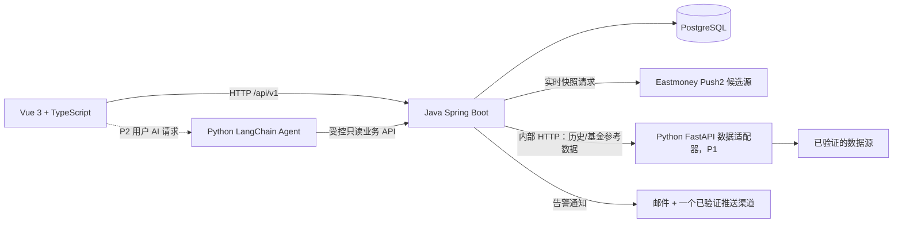

# StockCat 技术架构设计

- 文档版本：V1.0-Draft
- 架构策略：单用户、模块化单体优先；Python 服务作为独立 API 进程。
- 运行定位：第一版本地单机部署；应用进程直接在本机启动，仅 PostgreSQL 使用 Docker 运行。
- 核心原则：业务写入集中在 Java；外部数据源隔离；AI 不在告警关键路径上。

## 1. 逻辑架构

实线代表 P0/P1 主要数据路径；虚线代表 P2 才启用的 AI 请求路径。数据源和推送渠道均需验证后才能认定可用。

## 2. 技术栈

- 前端：Vue 3、TypeScript、Vite、Pinia。
- Java 服务：Java 21、Spring Boot 3、Spring Web、Validation、MyBatis（已定：数据访问统一使用 MyBatis，不用 JPA/JDBC 混用）。
- 数据库：PostgreSQL。
- 技术指标：P1 使用 Java ta4j。
- Python：Python 3.12+（具体小版本按依赖兼容性验证后锁定）、FastAPI、Pydantic；P2 使用 LangChain。
- 测试：Java JUnit 5；Python pytest；前端按实际采用的测试工具补齐。
- 部署：本地开发可用 Docker Compose 启动 PostgreSQL；应用进程可本机运行。Docker 不是业务逻辑依赖。

## 3. 服务职责与数据所有权

### 3.1 Vue

- 展示页面、表格、表单、加载/错误/空状态。
- 调用 Java 核心业务 API。
- P2 用户主动请求 AI 复盘时，可调用 Python Agent API。
- 不直接连接 PostgreSQL，不直接请求行情供应商。

### 3.2 Java 核心业务服务

负责：

- 标的与自选管理；监控标的管理（告警引擎的监控对象集合）。
- 交易日历和交易时段判断。
- 实时行情快照采集、标准化和最新快照查询（自选/监控标的 + 首页指数）。
- 告警规则、规则判断、冷却/去重。
- 告警事件、通知记录。
- 交易流水管理与**持仓计算**（由流水确定性聚合：摊薄成本、浮动/已实现盈亏；纯 Java 计算逻辑，单元测试覆盖）。
- 复盘与日记管理（市场复盘：按交易日一天一篇，含市场概况与板块分区；我的日记：树状长期笔记本，文件夹/文档统一树，深度 ≤5；P2 的 AI 复盘草稿经用户确认后转正式）。
- 首页总览聚合（指数 + 行情 + 持仓 + 告警摘要）。
- P1 指标计算和基金参考数据持久化。
- 提供给 Python Agent 的受控只读业务 API。
- 数据库迁移、业务数据权威写入。

### 3.3 Python 数据适配器（P1）

- 访问经过验证的历史行情、IOPV、基金净值等来源。
- 将供应商字段转换为内部约定格式。
- 返回数据给 Java；Java 校验后写入权威业务表。
- 不直接写业务数据库，不负责告警判断。

### 3.4 Python LangChain Agent（P2）

- 理解用户提出的复盘/查询问题。
- 通过受控工具调用 Java 只读 API。
- 对返回数据进行摘要、解释并标注时间范围和数据限制。
- 不直接执行 SQL，不直接写业务库，不修改规则，不触发业务通知。
- 模型或 Python 服务不可用时，Java 行情采集和告警仍需继续工作。

### 3.5 PostgreSQL

- 存储标的、自选、行情快照、交易日历、告警规则、告警事件、通知记录等。
- P3 以后如需要向量检索，可评估 pgvector；P0 不要求安装。

## 4. 调用方向

- Vue → Java：P0 所有核心业务。
- Java → 实时行情供应商：P0 快照采集。
- Java → Python 数据适配器：P1 历史/基金参考数据。
- Vue → Python Agent：P2 用户主动 AI 请求。
- Python Agent → Java：P2 只读业务查询。
- Python Agent 不直接访问 PostgreSQL。
- 禁止形成 Java 与 Python 互相同步调用的循环依赖。

## 5. P0 部署结构（本地单机）

P0 不要求所有服务容器化：前端、Java、Python 均直接在本机启动；只有 PostgreSQL 通过 Docker 单独运行。不为应用服务编写 Dockerfile 或 compose 定义，Docker 不是业务逻辑依赖。公网部署、HTTPS 与云端结构不在第一版范围内。

- Vue Vite 开发服务器：默认端口 5173。
- Java Spring Boot：默认端口 8080，统一 API 前缀 `/api/v1`。
- PostgreSQL：默认端口 5432。
- Python FastAPI：默认端口 8000，仅提供健康检查和预留契约；P2 再增加 Agent 路由。
- Vite 将 `/api` 代理到 Java 服务。P2 若前端直接访问 Python Agent，需要明确本地 CORS 或通过前端开发代理；不要在多个页面散落硬编码地址。
- 所有端口均可配置，以上为开发默认值。

## 6. 定时任务与市场时段

- `RealtimeSnapshotCollector`：根据配置轮询标的实时快照，建议初始间隔 5 分钟。
- `AlertEvaluationJob`：对有效且足够新的行情评估启用规则。
- 交易日历和交易时段判断在 Java 内统一实现。
- 任务必须具备可观测性：开始时间、结束时间、成功数、失败数、错误摘要。
- 防止同一任务在同一进程内重入；如果未来多实例部署，再引入分布式调度/锁设计。
- 不将每 5 分钟轮询的快照直接称为完整 5 分钟 K 线。

## 7. 异常与数据质量

- 数据源超时/限流/字段变化：适配器返回明确错误，记录日志和采集结果；不得覆盖有效新数据为零值。
- 数据过期：保留最近成功数据但标记过期；UI 同时展示行情时间和采集时间。
- 数据库不可用：业务写入失败必须可观测；不能假报成功。
- 通知失败：告警事件保留，通知记录标记失败并保存可安全展示的原因；可手动重试，自动重试策略后续明确。
- Python/LLM 不可用：不影响 Java 的行情采集和告警。
- 外部异常向前端返回统一错误结构，不返回堆栈和敏感配置。

## 8. 安全与配置

- API 密钥、邮件密码、推送 token 通过环境变量或本地未提交配置注入。
- `.env`、真实 token、个人凭据不得提交 Git。
- `.env.example` 只放占位值。
- P0 为本地单用户应用，可先不做复杂认证；若绑定非本机地址或部署公网，必须先补认证、HTTPS、访问控制和安全评估。
- 日志不输出密钥、完整授权头或敏感个人信息。

## 9. 关键架构决策

1. 采用模块化单体 Java 服务，不拆成多个 Java 微服务。
2. Java 是业务数据权威写入者。
3. Python 数据适配器只提供标准化数据；Java 验证并持久化。
4. AI Agent 只通过受控 Java API 读取业务数据。
5. ta4j 是 P1 指标计算的唯一实现。
6. P0 不引入 Redis、Kafka、pgvector。
7. 实时行情、历史 K 线、IOPV、净值是不同数据类型，分别验证和建模。
8. 持仓由交易流水确定性计算，是纯 Java 本地逻辑，不依赖行情源也能算出数量与成本；行情只影响市值与浮动盈亏的展示。
9. 交易流水和用户日记只能由用户操作产生；AI（P2）只能生成复盘草稿等待确认，不得修改交易记录、覆盖日记、修改规则或触发通知。
10. 告警规则类型可插拔：`alert_rule.rule_type`（开放枚举）+ `params JSONB`，Java 侧用评估器注册表（每个 rule_type 一个 `RuleEvaluator` 实现，启动时注册）调度评估；新增规则类型 = 新增一个 evaluator + 参数 schema，不改表结构和评估引擎。创建规则时校验该类型所需数据已接入，避免永不触发的"死规则"。
